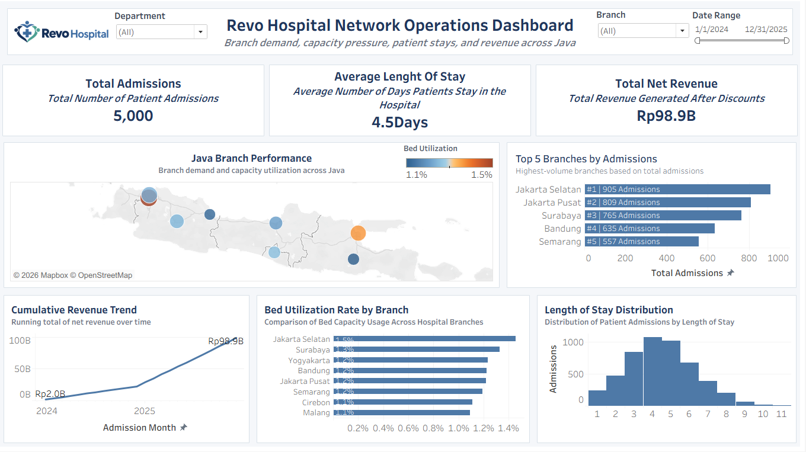
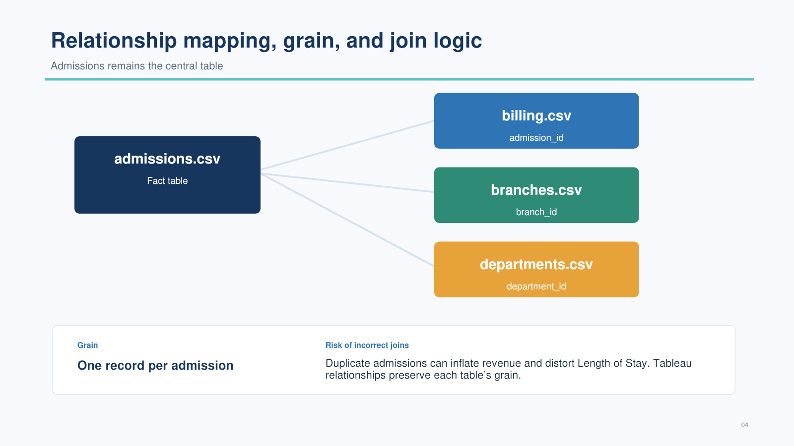

# Revo Hospital Network Operations Dashboard (Tableau)

An interactive **Tableau** dashboard that monitors patient demand, bed capacity, length of stay, and revenue across hospital branches in Java.
Data visualization project of the **RevoU Full Stack Data Analytics (FSDA) program, 2026**.

**Author:** Johannes Krysosthomus Thedens Dominggu ([LinkedIn](https://www.linkedin.com/in/johannes-krysosthomus-thedens-dominggu/))

📊 **Live dashboard:** [View on Tableau Public](https://public.tableau.com/views/RevoHospitalNetworkOperationsDashboard/Dashboard1)<br>
📄 **Presentation:** [Revo_Hospital_Network_Operations_Dashboard.pdf](presentation/Revo_Hospital_Network_Operations_Dashboard.pdf)



---

## 📌 Project Overview

Revo Hospital is a **fictional** hospital network with branches across Java.

- **Main user:** Network Operations Lead
- **Dashboard type:** Analytical
- **Decisions supported:**
  1. Compare patient demand between branches
  2. Identify capacity pressure and bed utilization
  3. Monitor length of stay and revenue contribution
  4. Make data-driven operational recommendations

> **Disclaimer:** Revo Hospital is not a real company. The dataset is **synthetic** and was provided for the class assignment. It is included in the [`data/`](data/) folder.

## 🗂️ Data Model

Four tables were used, with **admissions as the central fact table** (grain: one row per admission). Tables were connected with **Tableau relationships** to keep each table's grain and avoid duplicated revenue or length of stay.

| Table | Rows | Key | Description |
|-------|------|-----|-------------|
| [`admissions.csv`](data/admissions.csv) | 5,000 | `admission_id` | Admission records (Jan 2024 – Dec 2025), length of stay, admission type (fact table) |
| [`billing.csv`](data/billing.csv) | 5,000 | `admission_id` | Gross charge, insurance coverage, discount, and net revenue |
| [`branches.csv`](data/branches.csv) | 8 | `branch_id` | Branch city, province, latitude/longitude, tier, and bed capacity |
| [`departments.csv`](data/departments.csv) | 8 | `department_id` | Department names and service lines |

Column descriptions are in the [data dictionary](data/revo_hospital_data_dictionary.csv). The dictionary also lists `patients.csv` and `doctors.csv`, which were not used in this dashboard.



**Data preparation:**
- Converted `admission_date` and `discharge_date` to Date
- Converted latitude and longitude to Number for mapping
- Checked for missing values, data types, and duplicate admissions: **0 missing values, 0 duplicates**, and exactly one billing record per admission

## 📐 Metrics & Calculations

| Metric | Calculation | Purpose |
|--------|-------------|---------|
| Total Admissions | `COUNTD([Admission Id])` | Patient volume |
| Average Length of Stay (ALOS) | `AVG([Length Of Stay Days])` | Service efficiency |
| Bed Utilization Rate | Patient-days / available bed-days | Capacity usage |
| Total Net Revenue | `SUM([Net Revenue Idr])` | Financial contribution |
| Cumulative Revenue | Running total of net revenue | Revenue growth over time |

**Bed Utilization Rate (calculated field):**
```
SUM([Length Of Stay Days])
/
( MIN([Bed Capacity]) *
  (DATEDIFF('day', MIN([Admission Date]), MAX([Admission Date])) + 1) )
```

**Cumulative Revenue:** Quick Table Calculation → Running Total on `SUM([Net Revenue])`, computed using Admission Month.

## 🛠️ Tableau Features Used

- Calculated fields and table calculations (running total)
- Map with latitude/longitude, colored by bed utilization
- KPI cards, bar charts, line chart, and histogram
- **3 interactive filters:** Department, Branch, and Date Range
- Tooltips and descriptive titles so users can read the dashboard without opening separate worksheets

## 💡 Key Insights (2024–2025)

| KPI | Value |
|-----|-------|
| Total Admissions | **5,000** |
| Average Length of Stay | **4.5 days** |
| Total Net Revenue | **Rp 98.9 billion** |

1. **Patient demand is concentrated in major branches.** Jakarta Selatan has the most admissions (905), followed by Jakarta Pusat (809) and Surabaya (765).
2. **Bed capacity is not yet used optimally.** Bed utilization is only 1.1%–1.5% across branches, and it is uneven between branches.
3. **Most patients stay 3–6 days**, with an average of 4.5 days. About 13.7% of admissions stay longer than 6 days, which affects bed turnover.
4. **Cumulative revenue keeps growing**, with a steeper increase in 2025, reaching a cumulative Rp 98.9 billion by the end of 2025.

## ✅ Business Recommendations (OBIPR)

| Category | Business Impact | Priority | Recommendation |
|----------|-----------------|----------|----------------|
| **Admissions Distribution** | 905 admissions in Jakarta Selatan show concentrated patient load | High | Adjust medical staff and schedules to patient volume |
| **Bed Utilization** | 1.1%–1.5% utilization shows capacity is not optimal | High | Evaluate bed needs for each branch |
| **Patient Distribution** | Utilization is uneven between branches | High | Apply a patient referral system between branches |
| **Length of Stay** | ALOS of 4.5 days affects bed turnover | Medium | Strengthen discharge planning and review long-stay cases (> 6 days) |
| **Revenue Sustainability** | Net revenue of Rp 98.9 billion needs to be maintained | Medium | Monitor branch and service revenue regularly |

## 📁 Repository Structure

```
├── README.md
├── data/           # Synthetic dataset (4 CSV tables + data dictionary)
├── images/         # Dashboard screenshot and data model
└── presentation/   # Final presentation (PDF)
```

## 📝 Notes

- The low bed utilization rate (1.1%–1.5%) comes from the synthetic dataset, which contains a sample of 5,000 admissions compared with the full bed capacity of each branch.
- To rebuild the dashboard, connect the 4 CSV files in Tableau with `admissions.csv` as the central table, related to `billing` on `admission_id`, `branches` on `branch_id`, and `departments` on `department_id`.
- The interactive version of the dashboard is available on [Tableau Public](https://public.tableau.com/views/RevoHospitalNetworkOperationsDashboard/Dashboard1).
